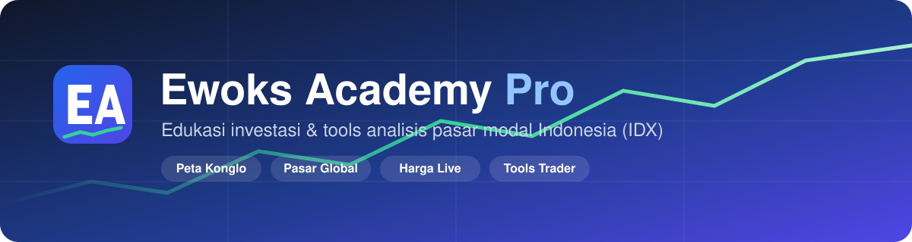

<div align="center">



<br>

[](https://rdsptwn.github.io/EAProInvesting/)
[](#-update-data-otomatis)
[](#-harga-live-opsional)
[](LICENSE)


**Platform edukasi investasi dan tools analisis pasar modal Indonesia.**
Data pasar, laporan keuangan, dan peta kepemilikan konglomerat, tanpa backend dan tanpa biaya server.

[**Buka Situs →**](https://rdsptwn.github.io/EAProInvesting/)

</div>

---

## ✨ Fitur Utama

| | Modul | Isi |
|---|---|---|
| 🏠 | **Beranda** | IHSG, sentimen pasar, inflasi, yield SBN, berita, kalender korporasi |
| 🧭 | **Peta Konglo** | Grup konglomerat, kepemilikan emiten, sejarah, harga, laporan keuangan 2020–2026 |
| 🌏 | **Pasar Global** | 130+ ETF, reksa dana, dan SBN: klasifikasi pasar (Developed → Frontier), CAGR, return per tahun |
| 🏦 | **Broker** | Database broker BEI (ritel, asing, lokal) |
| 📚 | **Edukasi** | Makro dan saham, fixed income, bandarmologi, kuis profil risiko |
| 🧮 | **Tools** | Watchlist, jurnal trading, trading plan, kalkulator bandar, dana pensiun, compounding, dana darurat |

## 🔄 Update Data Otomatis

Bot GitHub Actions meng-commit data ke repo, jadi situs selalu berisi data terbaru tanpa edit manual.

| Data | Jadwal (WIB) | Workflow |
|------|--------------|----------|
| IHSG, harga emiten, kalender korporasi | Senin–Jumat 09:00, 13:00, 17:00 | `daily-market-sync` |
| Inflasi YoY, yield SBN 10 tahun | Senin–Jumat 09:00, 13:00, 17:00 | `daily-market-sync` |
| CAGR dan return tahunan ETF | Senin–Jumat 09:00, 13:00, 17:00 | `daily-market-sync` |
| Laporan keuangan emiten | Senin–Jumat 18:30 | `sync-funda-idx` |
| Cache aset (`?v=`) | Setiap data berubah | otomatis |

> **Cek:** repo → **Actions**. Kalau kosong, buka **Settings → Actions → General** dan izinkan Actions, lalu **Run workflow** sekali untuk uji.

## ⚡ Harga Live (opsional)

Harga IHSG dan emiten diperbarui **tiap 10 menit saat jam bursa** lewat Cloudflare Worker gratis (data IDX tertunda ±10 menit). Tanpa Worker, situs memakai snapshot harian.
Panduan pasang ada di [`worker/README.md`](worker/README.md).

## 🗂️ Struktur Proyek

```text
.
├── *.html                   Halaman (beranda, konglo, pasar-global, tools, edukasi)
├── assets/
│   ├── js/ewoks-core.js     Navigasi, live price, snapshot, util bersama
│   ├── js/pages/            Logika per halaman
│   ├── data/                JSON hasil bot (snapshot, lapkeu, macro, pasar-global)
│   └── img/                 Logo EA dan banner
├── tools/                   Skrip build data (Node 20+)
├── worker/                  Cloudflare Worker proxy harga live
└── .github/workflows/       Sinkron data otomatis
```

## 🛠️ Jalankan Lokal

```bash
node tools/build-market-snapshot.mjs   # IHSG + harga emiten
node tools/build-funda-idx.mjs --force # laporan keuangan
node tools/build-pasar-global.mjs      # CAGR + return tahunan ETF
node tools/build-macro.mjs             # inflasi + yield SBN
node tools/bump-asset-version.mjs      # ganti versi cache
```

Situs ini statis, jadi cukup buka lewat server file apa saja (misalnya `npx serve`).
Jurnal dan watchlist tersimpan di browser (localStorage); gunakan Backup/Restore di situs.

## 🚀 Deploy

Push ke `main` → GitHub Pages. Setelah push, hard refresh (Ctrl+F5). Pages kadang butuh 1–2 menit.
Commit manual harus ikut menyertakan file data di `assets/data/` supaya situs tidak kembali ke versi lama.

## ⚖️ Lisensi

© 2026 Rakaditya Septiawan / Ewoks Academy. **All rights reserved.** Kode, konten, data, dan logo tidak boleh disalin atau didistribusikan ulang tanpa izin tertulis. Lihat [LICENSE](LICENSE).

## ⚠️ Disclaimer

Seluruh konten untuk edukasi, **bukan** saran beli atau jual. Data bisa tertunda atau berbeda dari sumber resmi. Lakukan riset sendiri (DYOR).
