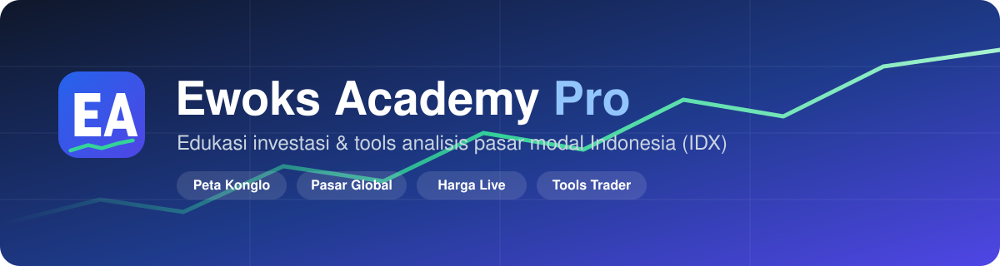

<div align="center">



<br>

[](https://rdsptwn.github.io/EAProInvesting/)
[](#-update-data-otomatis)
[](#-harga-live-opsional)
[](LICENSE)


**Platform edukasi investasi dan tools analisis pasar modal Indonesia.**
Data pasar, laporan keuangan, dan peta kepemilikan konglomerat, tanpa backend dan tanpa biaya server.

[**Buka Situs →**](https://rdsptwn.github.io/EAProInvesting/)

</div>

---

## ✨ Fitur Utama

| | Modul | Isi |
|---|---|---|
| 🏠 | **Beranda** | IHSG, sentimen pasar, inflasi, yield SBN, **BI 7-Day RR Rate**, **Fed Rate**, aktivitas perdagangan (All Market / Regular / Nego), top gainer-loser, berita, kalender korporasi |
| 🧭 | **Peta Konglo** | Grup konglomerat, kepemilikan emiten, harga, logo, dan laporan keuangan 2020–2026 untuk 348 emiten (termasuk 85 saham likuid non-konglo lewat kotak "Lapkeu emiten lain") |
| 🌏 | **Pasar Global** | Mode **IHSG / Global / Bitcoin / Forex**: 2.649 saham & ETF AS dengan fundamental, indeks dunia dan saham terkaitnya, komoditas, kurs, sektor, filter **Syariah (estimasi)**, 309 instrumen ETF/reksa dana/SBN |
| ₿ | **Bitcoin & Kripto** | 162 koin, Fear & Greed, tab Listing (pengumuman Binance + trending), harga live Binance |
| 💱 | **Forex & Emas** | 31 pasangan, XAU/USD, XAG/USD, PAXG, XAUT |
| 📓 | **Jurnal Multi-pasar** | Jurnal Global, Bitcoin, dan Forex dengan statistik, kurva equity, ekspor/impor |
| 💬 | **Tido, asisten chat** | Maskot chibi pengantuk yang sesekali terbang, lari, main mobil, gelantungan, atau ngejar kursor. Chat gratis (edukasi, bukan sinyal) lewat Worker `/ask`; otak yang sama bisa dipakai bot WA |
| ⌨️ | **Command chat** | `/pagi /siang /swing /scalp` (IHSG, Global, Kripto, Forex; budget mis. `/swing idx 500`), `/akum /bandar /topakum /ea /lk /analisa /fibo`, `/rd` (reksa dana RDPU/RDPT/RDS/RDC/RDI), `/istilah`, `/topreturn idx 1\|3\|5`, `/harga /berita /help`. Pertanyaan bahasa natural ("tido, swing di bawah 500") otomatis dialihkan ke command; hasilnya dari database situs, bukan dari AI |
| 🏦 | **Broker** | Database 91 broker BEI aktif (ritel, asing, lokal) dengan label kategori bandarmologi |
| 📚 | **Edukasi** | Makro dan saham, laporan keuangan, fixed income, bandarmologi, kuis profil risiko |
| 🧮 | **Tools** | Terminal watchlist dan screener (dengan **rekomendasi bot BoW** otomatis), jurnal trading, trading plan, kalkulator bandar, dana pensiun, compounding, dana darurat |

Tampilan memakai tema **Aurora**: terang atau gelap, kartu kaca, gradien indigo–magenta–aqua, ilustrasi grafik animasi di beranda. Animasi otomatis mati bila perangkat memilih *reduced motion*.

**Penanda status emiten.** Terminal menampilkan badge UMA, suspensi, notasi khusus, dan **HSC** (High Shareholding Concentration; 383 emiten sesuai pengumuman resmi BEI/KSEI 11 Nov 2026, lengkap dengan persentase konsentrasi), dapat difilter lewat "Status emiten".

## 🔄 Update Data Otomatis

Bot GitHub Actions meng-commit data ke repo, jadi situs berisi data terbaru tanpa edit manual.

| Data | Jadwal | Workflow |
|------|--------|----------|
| IHSG, harga emiten, kalender korporasi, inflasi, yield SBN, BI Rate, Fed Rate, ETF | Tiap jam, Senin–Jumat (09.00–17.00 WIB) | `daily-market-sync` |
| Aktivitas perdagangan BEI (nilai, volume, frekuensi) | Tiap jam, Senin–Jumat | `market-activity-intraday` |
| Laporan keuangan emiten | Senin–Jumat 18.30 WIB | `sync-funda-idx` |
| Arus kas dan dividen emiten BEI (dari Yahoo) | Sabtu 10.00 WIB + manual | `sync-funda-cf` |
| Return 1/3/5 tahun saham IHSG (untuk `/topreturn`) | Minggu 10.00 WIB + manual | `sync-ret5y` |
| Peringkat broker BEI | Harian | `sync-broker` |
| Global: screener, indeks dunia, komoditas, kripto, forex, listing kripto | Harian + manual | `sync-global` |
| Fundamental global dan estimasi syariah | Berkala | `sync-global-funda` |
| Cache aset (`?v=`) | Setiap data berubah | otomatis |

**Soal kesegaran data.** BEI hanya menerbitkan ringkasan perdagangan **setelah penutupan**, jadi kartu Aktivitas Perdagangan menampilkan data penutupan terakhir beserta jam pengecekan, bukan angka real-time. Harga saham dan IHSG yang lebih dekat ke real-time datang dari Worker di bawah.

**Pemicu tepat waktu.** Jadwal `cron` bawaan GitHub sering tertunda berjam-jam. Karena itu Cloudflare Worker (Cron Trigger) memicu kedua workflow tiap jam lewat `workflow_dispatch`. Pemasangannya ada di [`worker/README.md`](worker/README.md).

> **Cek:** repo → **Actions**. Run bertanda `workflow_dispatch` pada jam genap berarti Cron Trigger bekerja.

## ⚡ Harga Live (opsional)

Harga IHSG dan emiten diperbarui tiap 10 menit saat jam bursa lewat Cloudflare Worker gratis (data IDX di Yahoo tertunda ±10 menit). Tanpa Worker, situs memakai snapshot terakhir. Bila koneksi ke Worker gagal, kartu Market Sentiment mencantumkan alasannya.
Panduan pasang: [`worker/README.md`](worker/README.md).

**Asisten AI (Worker v8).** Rute `POST /ask` memakai rantai penyedia gratis Gemini → Groq → Workers AI, dengan cache jawaban dan batas per perangkat. Secret: `GEMINI_KEY`, `GROQ_KEY` (opsional), `BOT_KEY` (untuk bot WA). Kuota penyedia gratis dibagi semua pengunjung.

## 📋 Status & Daftar Tertunda

Ringkasan update yang menunggu tindakan dan data yang belum terisi ada di [`docs/STATUS.md`](docs/STATUS.md).

## 🗂️ Struktur Proyek

```text
.
├── *.html                   Halaman (beranda, konglo, pasar-global, tools, edukasi)
├── assets/
│   ├── css/app.css          Komponen dasar (kartu, nav, input)
│   ├── css/theme.css        Tema Aurora (terang/gelap, hero, kontras)
│   ├── js/ewoks-core.js     Navigasi, live price, snapshot, aktivitas pasar
│   ├── js/pages/            Logika per halaman
│   ├── data/                JSON hasil bot (snapshot, lapkeu, macro, pasar-global)
│   └── img/                 Logo EA dan banner
├── tools/                   Skrip build data (Node 20+, plus import-bei-indices.py)
├── docs/STATUS.md           Daftar update tertunda dan data belum terisi
├── worker/                  Cloudflare Worker proxy harga live
└── .github/workflows/       Sinkron data otomatis
```

## 🛠️ Jalankan Lokal

```bash
node tools/build-market-snapshot.mjs   # IHSG + harga emiten
node tools/build-funda-idx.mjs --force # laporan keuangan
node tools/build-pasar-global.mjs      # CAGR + return tahunan ETF
node tools/build-macro.mjs             # inflasi, yield SBN, BI Rate, Fed Rate
node tools/build-market-activity.mjs   # aktivitas BEI (butuh Playwright)
node tools/build-global.mjs [members|screener|commodities|crypto|forex|intl|news|ipo|funda]
node tools/build-global-syariah.mjs    # estimasi syariah global
node tools/build-crypto-listings.mjs   # berita listing kripto
python3 tools/import-bei-indices.py <folder xlsx BEI>  # LQ45, IDX80, ISSI, dll.
node tools/bump-asset-version.mjs      # ganti versi cache
```

Situs ini statis, jadi cukup buka lewat server file apa saja (misalnya `npx serve`).
Jurnal dan watchlist tersimpan di browser (localStorage), per browser dan per perangkat, bukan per IP; gunakan Backup/Restore atau Ekspor/Impor di situs untuk memindahkan.

## 🚀 Deploy

Push ke `main` → GitHub Pages. Setelah push, hard refresh (Ctrl+F5). Pages kadang butuh 1–2 menit.
Commit manual harus ikut menyertakan file data di `assets/data/` supaya situs tidak kembali ke versi lama.

## ⚖️ Lisensi

© 2026 Rakaditya Septiawan / Ewoks Academy. **All rights reserved.** Kode, konten, data, dan logo tidak boleh disalin atau didistribusikan ulang tanpa izin tertulis. Lihat [LICENSE](LICENSE).

## ⚠️ Disclaimer

Seluruh konten untuk edukasi, **bukan** saran beli atau jual. Data bisa tertunda atau berbeda dari sumber resmi. Lakukan riset sendiri (DYOR).
